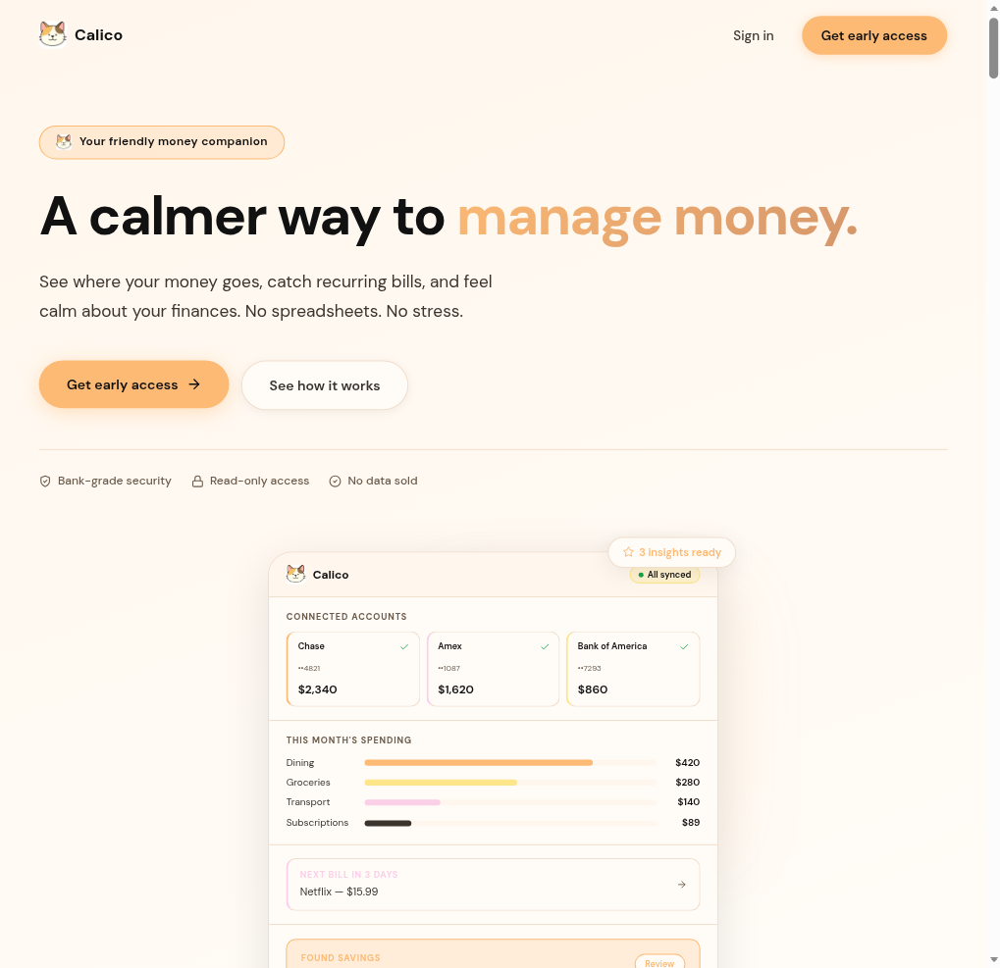
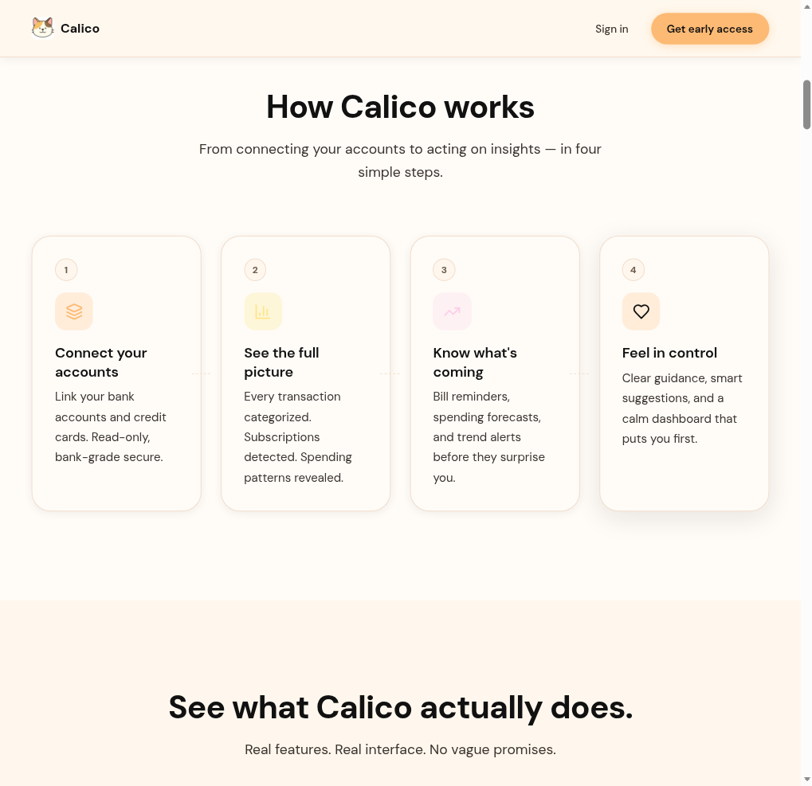
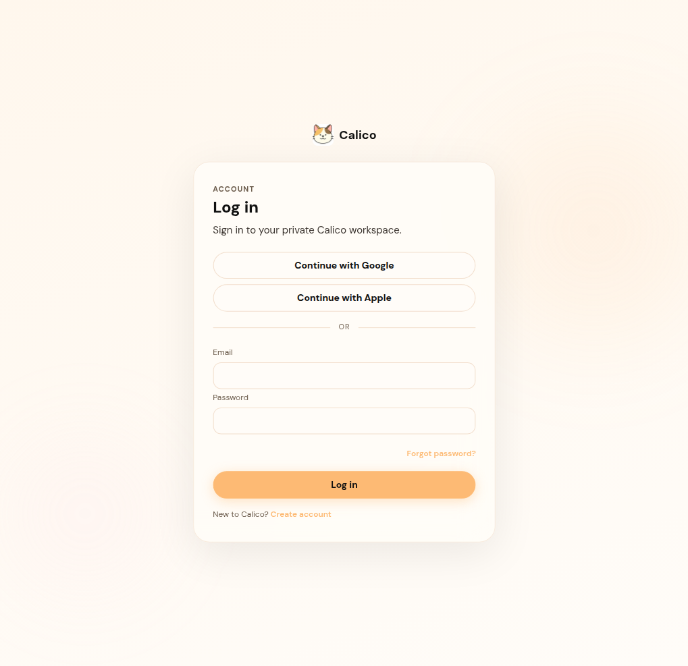

# Agent Wallet

Personal finance workspace with a Postgres ledger wallet. Link accounts, review spending and bills, and move wallet funds through Stripe only when guardrails and an approved recipient allow it.

Live app: [https://agent-wallet-one.vercel.app](https://agent-wallet-one.vercel.app)

## Screenshots

These are the public pages on the deployed app. The balances, merchants, and “found savings” figures on the marketing page are layout samples in the landing component, not live account data.

Signed-in screens (home, wallet, tasks) need an account. TODO: add screenshots of those views from a real signed-in session.







The deployed build in these images still shows the previous interface name. Interface copy in this repository says Agent Wallet.

## What it does

- Email and password accounts, plus Google and Apple sign-in.
- Plaid Link for connected institutions. Link tokens request the Plaid `transactions` product, and some flows also request `auth` (account and routing data). This is not a read-only-only integration.
- Signed-in screens for home, accounts, transactions, budgets, cash flow, recurring bills, subscriptions, statements, insights, goals, investments, reports, advice, tasks, automations, a control center, wallet, and settings.
- Natural-language command parsing (`POST /api/ai/command`) through Anthropic when `ANTHROPIC_API_KEY` is set. If that key is missing, parsing falls back to a local overview instead of calling a model.
- Receipt parsing can call Gemini when `GEMINI_API_KEY` or `GOOGLE_API_KEY` is set.
- A separate wallet ledger for top-ups and sends. That balance is not the same number as linked-bank balances.

Some account, transaction, budget, and goal screens can also store manual records in the browser. Those records are not the wallet ledger.

## Wallet balance

Available wallet balance is computed on the server from `ledger_entries`:

`sum(succeeded credits) - sum(succeeded debits)`

- A user with no succeeded rows is at `$0.00`. Nothing in the schema seeds demo credits.
- Rows with status `pending`, `failed`, or `canceled` do not change the balance.
- `GET /api/wallet` is what the wallet UI loads. The balance is not stored in `localStorage`.

Default per-user settings, stored on `wallet_users` and editable with `PATCH /api/wallet/settings`:

| Setting | Default |
| --- | --- |
| Max transaction | $50 |
| Daily limit | $100 |
| Monthly budget | $500 |
| Approval threshold | $10 |

## Funding

1. An authenticated client calls `POST /api/funding/create-session` with an amount of at least `$0.50`.
2. The server creates a Stripe Checkout Session only when that user’s Stripe tool is connected and enabled. Checkout methods are `card`, plus `cashapp` when `STRIPE_ENABLE_CASHAPP_PAY=true`.
3. `POST /api/stripe/webhook` checks the `stripe-signature` header with `STRIPE_WEBHOOK_SECRET`. `POST /api/stripe/webhooks` runs the same handler.
4. On `checkout.session.completed` or `payment_intent.succeeded` for a top-up, the server writes one succeeded ledger credit. A repeated payment intent does not credit twice. If Stripe reports an Apple Pay card wallet or Cash App Pay, the credit description says so.
5. The wallet UI reads the new balance from `GET /api/wallet`.

`POST /api/webhooks/stripe` is a different handler (payment-intent and refund events). It is not an alias of the top-up webhook.

## Sends

1. An authenticated client calls `POST /api/wallet/send`.
2. The server checks the amount, balance, max transaction, daily limit, monthly budget, merchant allow and block lists, and the approval threshold.
3. The recipient must already be approved. Stripe sends require a Stripe connected account id on that recipient. The server then calls `stripe.transfers.create`.
4. A succeeded debit is written only after that transfer call returns. A failed transfer attempt is stored as a `failed` debit, which does not reduce available balance.
5. Cash App and bank recipients can be saved. Sending to them returns HTTP 501 because those executions are not implemented.

Optional idempotency: `x-idempotency-key` or `idempotencyKey` in the body.

## Automation

The task flow can plan actions such as subscription cancel, subscription negotiate, trial review, savings transfer, bill pay, and debt optimization.

Execution goes through the Tiny Fish adapter only when both `TINY_FISH_API_URL` and `TINY_FISH_API_KEY` are set, and only for action types marked live. Other types stop at a plan and tell the user automatic execution is not wired. There is no `POST /api/tinyfish` route and no `POST /api/reason` route.

## Stack

Next.js 16, React 18, TypeScript, Tailwind CSS, Postgres (`pg`), Stripe, Plaid, Zod, and the Anthropic SDK. Sentry is optional.

Startup validation in `security/secretsManager.ts` requires `DATABASE_URL`, `AUTH_SESSION_SECRET`, `STRIPE_SECRET_KEY`, `STRIPE_WEBHOOK_SECRET`, `PLAID_CLIENT_ID`, `PLAID_SECRET`, one of `DATA_ENCRYPTION_KEYRING` or `DATA_ENCRYPTION_MASTER_KEY`, and at least one of `OPENAI_API_KEY`, `ANTHROPIC_API_KEY`, or `CLAUDE_API_KEY`.

That last check only tests that one of the three variables is non-empty. This repository does not call the OpenAI API, and command parsing reads `ANTHROPIC_API_KEY` specifically. `CLAUDE_MODEL` can override the Anthropic model list in `lib/server/claude.ts`. The code default list starts with `claude-opus-4-5-20251101`.

## Routes

Wallet and money movement:

- `GET /api/wallet`
- `PATCH /api/wallet/settings`
- `GET`, `POST`, and `PATCH /api/wallet/recipients`
- `POST /api/wallet/send`
- `POST /api/funding/create-session`
- `POST /api/stripe/webhook` and `POST /api/stripe/webhooks`

Other areas with route handlers under `app/api/` include auth, Plaid connect, statements, insights, tasks, billing, referrals, and `POST /api/ai/command`. The full list is the files in that directory.

## Database

Postgres (`DATABASE_URL`) stores users, sessions, the wallet ledger, Plaid-linked data, tasks, and referrals.

Wallet-related tables in `db/schema.sql` include `wallet_users`, `wallet_recipients`, `ledger_entries`, `stripe_webhook_events`, `agent_tasks`, `web_action_logs`, and `approval_decisions`. Those are not the only tables. Later changes live in `db/migrations/`.

## Local setup

```bash
npm install
cp .env.example .env.local
npm run dev
```

`.env.example` has placeholders only. Do not commit `.env.local`.

Forward Stripe webhooks to the local app:

```bash
stripe listen --forward-to localhost:3000/api/stripe/webhook
```

Checks:

```bash
npm test
npm run lint
```

`npm run lint` is `tsc --noEmit`.
